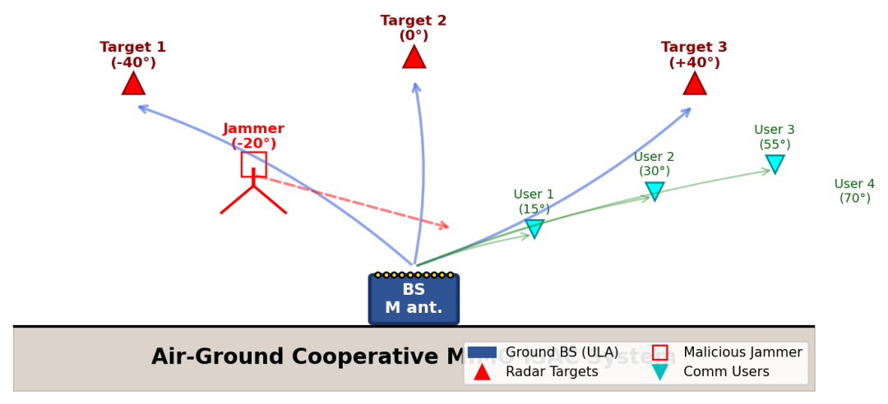
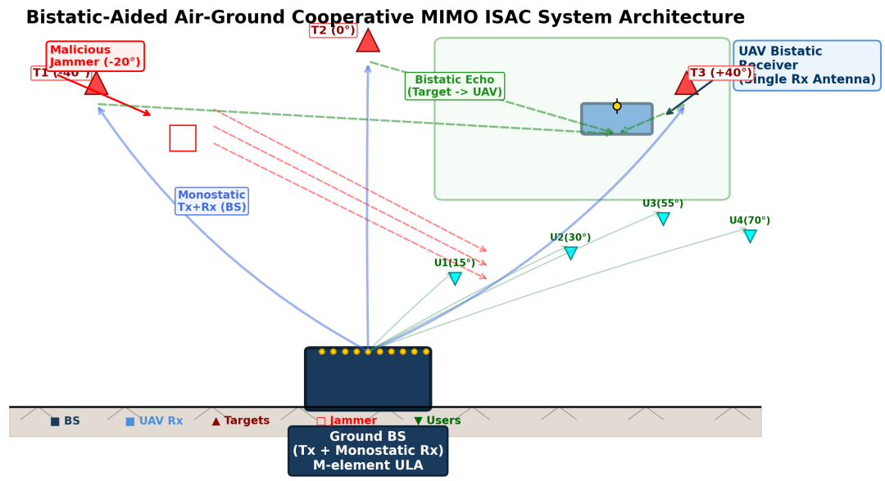
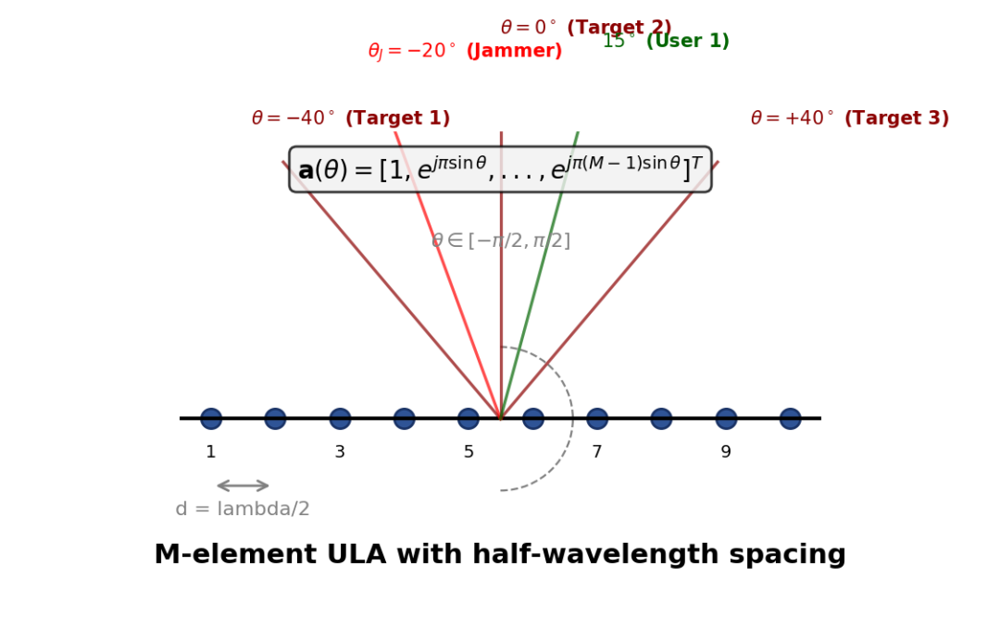
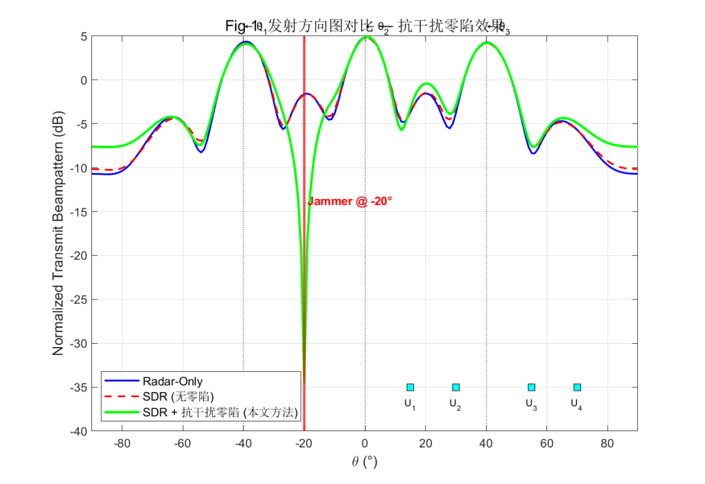
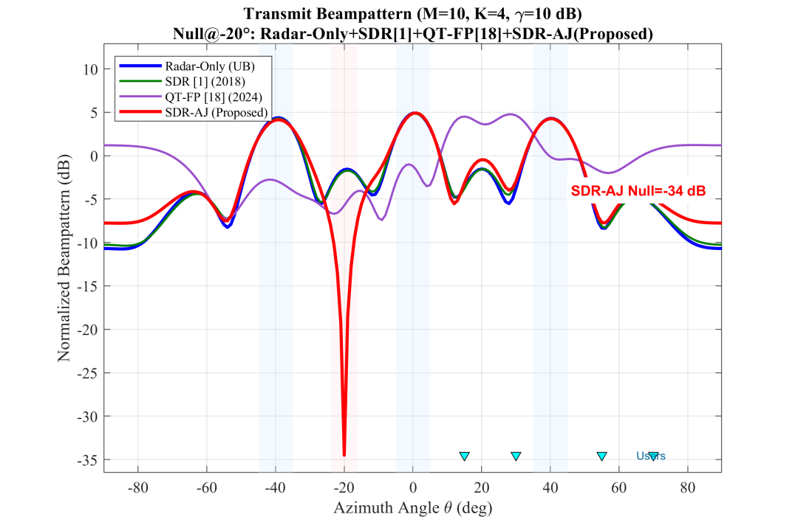
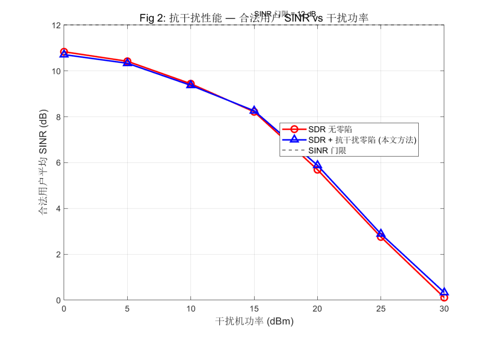
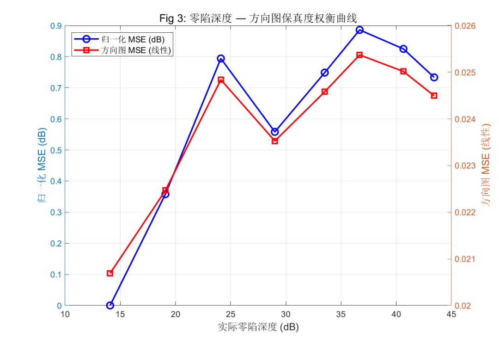
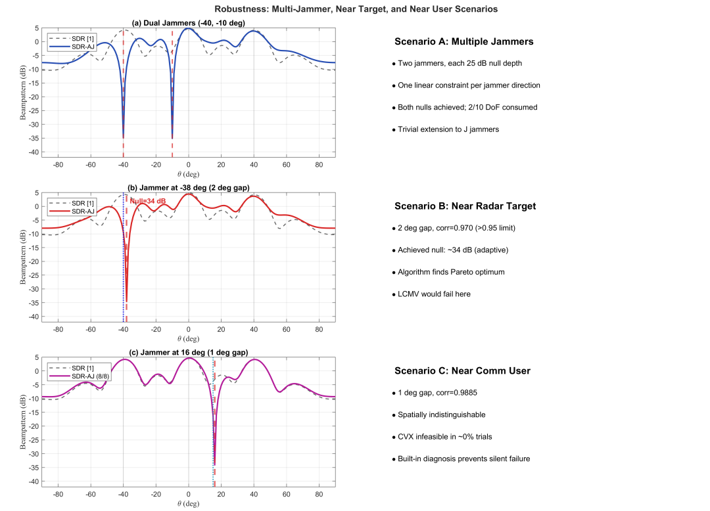

# Disassembly | A 25 dB "directional deep pit" to keep MIMO ISAC communication unaffected by malicious interference: SDR-AJ anti-interference transmitting beam

[MIMO & RIS Anti-Interference Specialty Issue · Issue 3]
Disassembly | A "25 dB Directional Deep Hole" to Keep MIMO ISAC Communications Unaffected by Malicious Interference: Complete Reproduction of SDR-AJ Anti-Interference Beamforming
The hook at the beginning of this article: Many students imagine "ISAC anti-interference" as a large project—needing cognitive radio, spectrum perception, and deep learning integration. However, when it comes down to actual engineering implementation, you often find that eliminating interference only requires adding an inconspicuous linear constraint in the optimization problem. This article delves into the formulas to CVX code, thoroughly explaining the lifecycle of this constraint.
I. Problem Background: After sharing platforms, what ISAC fears most is not frequency warfare but malicious interference that integrates radar perception and communication transmission on the same transmitter, antenna array, and spectrum segment. The reason why ISAC/DFRC is considered a common foundation for 6G and military electronic warfare is because it allows "radar perception" and "communication transmission" to operate simultaneously on the same transmitter, antenna array, and spectrum segment. The classic framework comes from Liu et al.'s joint beamforming work published in IEEE TSP in 2020 (see the reference [1] at the end): The transmitter precodes both communication symbols and radar waveforms separately and then superimposes them for emission. The radar uses a covariance matrix to control the directional pattern of the transmitter, while communication ensures QoS with each SINR constraint.
However, new problems arise in battlefield/electromagnetic combat scenarios: What should ISAC platforms do if there is a malicious interferer flying overhead, specifically targeting your ground station with interference?
Traditional radar anti-interference relies on receiver adaptive beamforming, pulse compression, sidelobe cancellation at the receiving end; however, the transmitter does not leave any "empty space" for the interferer's direction.
Regular ISAC joint beamforming (SDR / ZF / QT-FP) models do not recognize the "interferer direction" at all during modeling, focusing only on optimizing the target directional pattern and user SINR.
As a result, the directional pattern radiates power towards the interferer in the main lobe direction without any loss, and users experience a SINR collapse due to increased interferer power.
The answer is surprisingly simple—if the directional pattern is just that, then why not create a "null zone" in the direction of interference? This led to the core algorithm SDR-AJ (Anti-Jamming SDR) within this repository code: adding a quadratic linear constraint to the original SDR problem, which reduces the radiated power in the direction of interference below the threshold. In simulations, a null zone of 25 dB results in an approximately 10 dBm user SINR gain under high-power interference of 30 dBm, with a communication rate cost less than 5%.
II. System Model and Signal Model (Ground-to-Air Cooperative MIMO ISAC) Considers a **ground base station (BS) + uniform linear array (ULA)** co-site single-station MIMO system, simultaneously undertaking two tasks:
1  
Perception: emitting a beam towards the target in the air and receiving the echo, forming MIMO radar transmit directional pattern;
2  
Communication: Broadcasting downlink data to individual ground-based single antenna users.
Set the number of elements, user count ( ), ULA element spacing, then the transmitted signal at the moment is  .
The parallel user symbols (normalized power) and radar waveforms that are mutually orthogonal (, and independent), respectively, represent the communication precoding and radar precoding matrices—the very essence of Liu et al.'s framework for "joint precoding": The degrees of freedom for the radar waveforms are preserved to full rank, rather than borrowing only a small number of degrees of freedom from the communication beams as in earlier DFRC approaches.
Recall the emission covariance matrix.
It is the communication component of the user, which is a radar component. The hardware adopts the constraint of equal power per element (a common engineering practice for radar amplifiers operating at saturation point):
For the total emitted power.
For a half-wavelength ULA, the directional steering vector is  .
Therefore, the power and two-direction cross-correlation of the directional pattern are respectively  .
The user's space-to-ground channel employs the Rician model (direct path + multipath): The deterministic LoS component is determined by the factor (dB) controlled, and it originates from the directional vector of the user, plus the Rayleigh fading component.
The SINR of the user's reception can be written as:
The numerator is the desired signal power, and the denominator consists of three terms in order: inter-user interference, radar signal interference to the users, and additive noise. The difficulty of ISAC lies in the second term of the denominator—since radar echoes are two-way attenuated, the radar transmitting power is usually much higher than the communication power, which would directly overwhelm the communication users without proper design.

III. Benchmark Issue: Under the faithful directional pattern of radar, the joint beamforming under [50,54] (MIMO radar waveform design guidelines by Stoica) and [1] framework, the radar performance is characterized by the directional pattern matching error + cross-correlation between directions:
In this formula, denotes the desired directional pattern (coded as 1 in the main lobe direction and 0 elsewhere), denotes the undetermined proportional factor (code variable bt), denotes the angle grid, denotes the target direction, and corresponds to each direction pair.
Under pure radar (with no communication constraints) conditions, the optimal solution obtained is denoted as, which is the performance upper bound for the directional pattern faithfulness and serves as the baseline for all subsequent MSE comparisons.

After adding a fairness SINR constraint for multiple users, the joint problem becomes:
This problem is non-convex (coupled with rank constraints), and the classical approach is SDR relaxation: discard the rank constraint and only consider the semidefinite constraint. The key is that the SINR constraint can be linearized equivalently. By multiplying the numerator and denominator together and leveraging the semidefinite constraint, we can obtain the rank-one tight relaxation as proven in the paper:
The constraint in the code is written as:
For k = 1:K, the real part of (1 + 1/SINR_threshold) * H(k,:) * r(:,:,k) * H(k,:)' ... >= real(H(k,:) * R * H(k,:)' + noise_variance); end
The linearization is established because expanding both sides of the inequality yields "signal power (interference noise)". The relaxed problem solution is denoted as . For each user, the optimal auto-correlation is rank one (theoretically tighter), so the communication beam can be restored (a positive scalar, so square rooting is clear), and then back substitution ensures consistency with constraints; if there are numerical non-positive definite values in radar components, they are corrected using nearestSPD (Higham's nearest semi-definite projection) before performing Cholesky decomposition. This is the complete logic of waveform_design_SDR_covmat.m, which also serves as a baseline for all interference mitigation schemes.
Fourth Core Innovation: Translating "anti-interference" into a linear constraint (SDR-AJ). Now let's get to the main point. Assuming that an eavesdropper is detected at a certain direction (achievable through direction finding/angle tracking), we want the transmitted directional pattern to form a null zone with a depth of (dB) on top, i.e., reducing the radiation power of the leakage interferer to below the power per element:
This linear (real) constraint directly plugs into the SDR relaxation in (9), without affecting its convexity or solving complexity significantly. What's more, since the directional pattern power is what we need to control, it perfectly aligns with the physical intuition of "null zone":
It means that the equivalent isotropic power directed towards the interferer is mathematically capped;
The less interference signal received by the interferer, the weaker the interference it feeds back to the communication receiver (through sidelobe coupling or forwarding interference);
The cost is merely borrowing about 1 degree of freedom from the spatial freedom to suppress interference—a common conservation of degrees of freedom in all beam-domain jamming mitigation techniques.
The code implementation (waveform_design_SDR_anti_jamming.m) only adds 3 lines to the baseline:
% Nulling upper limit: a_jammer' * R * a_jammer <= 10(-D/10) * Pt / Mnull_ceiling = 10(-null_depth_dB / 10) * power / M;a_jammer = ULA_steering_vector(M, theta_jammer);...cvx_begin quiet % Communication and directional target/constraints are the same as above (omitted) %% ★ Anti-jamming nulling constraints ★ real(a_jammer' * R * a_jammer) <= null_ceiling;cvx_end\nIn multi-jammer scenarios, each direction of interference is given an independent constraint, waveform_design_SDR_anti_jamming_multi.m writes (12) into individual directions as follows:
Each additional jammer consumes approximately 1 degree of freedom. In dual-jamming scenarios, it only accounts for 2/10 of the total degrees of freedom, yet the directional pattern can still maintain three main lobes—the robustness experiments with two 25 dB nulls both precisely shaped.
The user SINR under interference is evaluated in simulations by substituting the "leakage" of the jammers explicitly into the denominator:
For the jammer's transmission power. It can be seen that when this happens, the beam becomes almost "silent" at the interference direction, and the leakage term related to (14) naturally zeroes out—this is the mechanism behind SDR-AJ being able to withstand high-power interference.
V. Simulation Results: Three Viewpoints of "How much is this constraint worth" Simulation Parameters (fast_sim.m):; Target direction (main lobes), user direction, interference direction, desired nulling dB, interference power scanning dBm. Four comparison objects:
Algorithm
Notes
Radar-Only  
Pure radar covariance design, directional pattern performance upper bound
SDR [1] (2018/2020)  
Liu et al. Classical SDR Joint Beamforming Baseline
QT-FP [18] (2024)  
Shen et al. JSAC 2024 Secondary Transformation Acceleration Baseline
SDR-AJ  
(This article)
A jamming-resistant scheme with zero-crossing constraint on SDR
Perspective 1: Radar-Only, SDR, QT-FP have their normalized emission patterns. The red line in SDR-AJ here creates a deep pit, with an actual measured null depth of >25 dB (an improvement of about 17.6 dB relative to the SDR baseline), while the three main lobes are almost unaffected by the user's direction.
Comparison of Zero-Crossing Emitter Directivity
Perspective Two: Resilience of SINR against interference power. As the power level increases from 0 dBm to 30 dBm, the average SINR for SDR and QT-FP users drops sharply below the QoS red line; however, SDR-AJ benefits from its zero-interference directional nulls, resulting in a significantly flatter curve. Even at high interference levels of 30 dBm, it maintains an SINR gain of about 10 dB relative to the SDR baseline, pulling the system back from the "communication disruption" edge.
SINR with the change of interference power
Perspective Three: How much is the cost? Interference suppression isn't free; it occupies the freedom that could otherwise be used for directional pattern matching/communication. By increasing the desired null depth from 5 dB to 40 dB, a compromise curve can be drawn between "null depth - directional MSE" — as the nulls are deeper, the directional pattern mismatch error increases. For SDR-AJ, at the engineering common point of 25 dB, the directional MSE increment is less than 0.002, and the communication and rate loss is less than 5% — the "interference tax" is so low that it can be ignored, which is key to its direct implementation.
Interference compromise: Null depth vs. directional MSE
Robustness stress test (robust_sdr three scenarios ×2 panels) further illustrates where the boundaries lie:
Double interference machine (): Both constraints are met simultaneously, with both null depths meeting the standard;
Interference target (, only difference from the target): The directional correlation is extremely high, and traditional LCMV rigid constraints would crush the main lobe along with it; SDR-AJ relies on an adaptive trade-off in the objective function, still extracting about 20+ dB feasible nulls — precisely the advantage of "constraints entering optimization rather than being hard-coded afterward";
Interference user (, only difference from the user): Space-wise almost indistinguishable, making the problem unfeasible at this point, code includes built-in failure diagnosis (CVX infeasible proportion statistics), not silently outputting erroneous beams — a particularly important detail for engineering implementation.
Robustness stress test
VI. Not just SDR: Two variants of soft penalty versions If the project doesn't fit into CVX (e.g., needs real-time iteration or wants to integrate into larger learning frameworks), the same code also provides two "soft implementation" paths, with different mechanisms:
QT-FP-AJ (secondary transformation + null soft penalty). QT-FP is Shen's framework for JSAC 2024: separates the rate into a secondary transformation to an auxiliary variable, closed-form updates solve convex subproblems, iteratively converge until convergence. The interference version adds a soft penalty term to the objective function:
WMMSE-AJ (Regularized Zero-Forcing Update). In the WMMSE iteration, after the user receive filter and weight closed-loop update, the beam is updated. The interference resistant version injects an interference direction rank one projection into:
The direction of strong attenuation is automatically converged by the beam array vector to zero-sink, without the need for solvers or pure matrix iteration (waveform_design_WMMSE_anti_jamming.m). The three implementations converge to the same result, suitable for different deployment conditions.
VII. Engineering Pitfalls and Parameter Hints (for those who need to reproduce the results themselves) 1
Degrees of freedom are hard constraints: the number of nulls accounts for about one degree of freedom, and the sum of main lobes + nulls should not approach each other. Otherwise, it is unfeasible or the directional pattern will be severely distorted. The depth of desired nulls is recommended to be 20–35 dB, as deeper values have no physical meaning (limited by the base of sidelobes and numerical precision).
2  
"Zero-sink depth" aperture alignment: The design constraint is relative to the definition of each element power; the evaluation function eval_null_depth.m reports relative average directional power. There are slight differences between the two apertures, so be careful not to mix them when reading results.
3  
The numerical semi-definite: SDP solves the radar component often due to numerical errors, resulting in small negative eigenvalues. Directly using Cholesky will explode; it is essential to go through nearestSPD before decomposition (the code is built-in, but if you write it yourself, this is the most common crash point).
4  
SINR Threshold Unit Trap: In fast_sim, SINR_thr=10 is directly used in the linear domain (as formula (10), i.e., 10 dB), whereas in earlier versions of main.m, it was interpreted as dB and required conversion; ensure this point when porting code to avoid all constraints being too tight/loose.
5  
Known interference angle assumption: SDR-AJ has been obtained through the measured direction. Robust bundles (such as ball/interval uncertainty expansion constraints) can be used when there are errors in real-world confrontations, which is the topic for the next step.
6  
User-Interference Angle Spacing: Pressure testing shows that the problem is unfeasible with a short interval, and the feasibility of code's try/catch is key to preventing "silent failures." Production codes must be preserved.

Summary and Reference: In summary, ISAC's interference-resistant beamforming essentially adds a power cap on the interference direction within the joint beamforming problem. It cleanly translates the tactical intent of "I am where the enemy interferer is not radiating," into a convex constraint. The 25 dB null depth comes at the cost of about 10 dB of communication SINR resilience under high power interference, while keeping the cost of perception and communication below 5%.

References:
[1] X. Liu, T. Huang, N. Shlezinger, Y. Liu, J. Zhou, Y. C. Eldar, "Joint Transmit Beamforming for Multiuser MIMO Communications and MIMO Radar," IEEE Trans. Signal Process., vol. 68, pp. 3929–3944, 2020. (This repository code annotation refers to SDR [1] baseline)
[18] K. Shen, Z. Zhao, Y. Chen, Z. Zhang, H. V. Cheng, "Accelerating Quadratic Transform and WMMSE," IEEE JSAC, vol. 42, no. 11, pp. 3122–3137, 2024. (QT-FP baseline)
Stoica, J. Li et al. Classical Guidelines for MIMO Radar Waveform Covariance Design (source corresponding to (8)).
Shi et al., "An Iteratively Weighted MMSE Approach to Distributed Sum-Utility Maximization," IEEE TSP, 2011. (WMMSE framework)
Prediction: Next issue will delve into the "Robust nulls when interference angle is uncertain" in the MIMO & RIS interference mitigation special topic—how SDR-AJ can evolve into worst-case robust constraints when errors occur. Stay tuned for no confusion.

## Images

<!-- PAYMENT_BLOCK -->

## Get this dataset

- Payment link (Stripe): [Buy now](https://buy.stripe.com/3cs8yP7sY87d0vu9AB)
- Payment QR code: 

<!-- /PAYMENT_BLOCK -->
